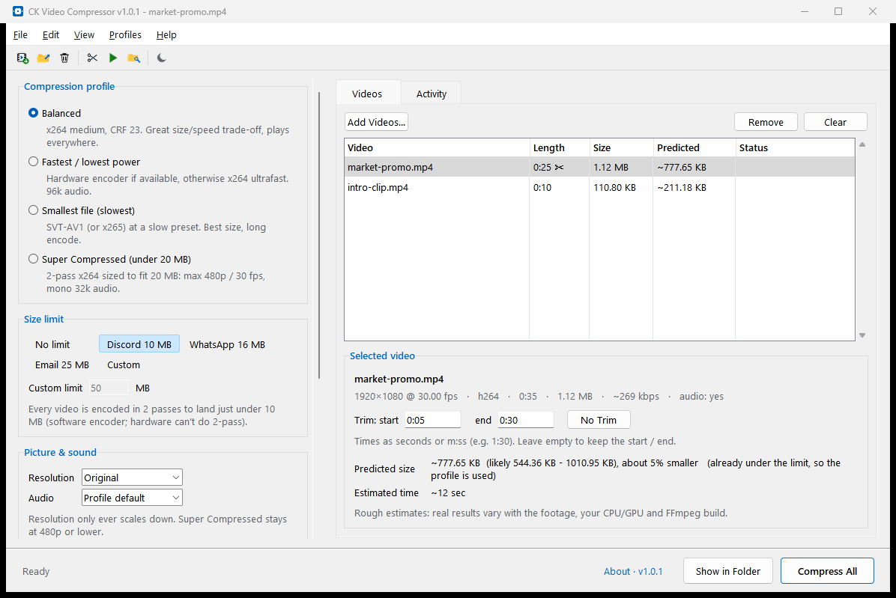
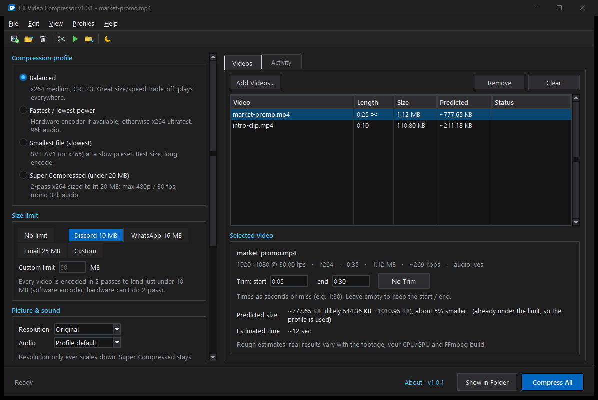

<p align="center">
  
</p>

<h1 align="center">CK Video Compressor</h1>

<p align="center">
  Shrink videos with FFmpeg: pick a profile or a size limit, see the predicted size, and compress one or many.<br>
  Built-in trim, fast presets, custom limits, and full Light & Dark mode support.
</p>

<p align="center">
  <a href="https://github.com/project-ceekay/ck-video-compressor/releases/latest"></a>
  <a href="https://github.com/project-ceekay/ck-video-compressor/releases"></a>
  
  <a href="LICENSE"></a>
</p>

<p align="center">
  <a href="https://github.com/project-ceekay/ck-video-compressor/releases/latest"><b>Download</b></a> ·
  <a href="https://cksoftware.netlify.app/video-compressor.html">Website</a> ·
  <a href="CHANGELOG.md">What's new</a> ·
  <a href="https://cksoftware.netlify.app/">More CK Software</a>
</p>

<p align="center">
  
  
</p>

Part of the **CK Suite**, a set of small, free Windows tools by [CK Software](https://cksoftware.netlify.app/).

## Features

- **Batch queue:** Drop videos or whole folders anywhere onto the window.
- **Top Menu Bar & Toolbar:** Classic menus (`File`, `Edit`, `View`, `Profiles`, `Help`) and a 2×-supersampled procedural icon toolbar with hover tooltips and instant feedback.
- **Light & Dark Mode:** Full native dark theme styling title bars, menus, toolbar, panels, queue list, and activity log.
- **Profiles:** Balanced, Fastest (hardware encoder when available), Smallest file (AV1 / HEVC), Super Compressed (under 20 MB).
- **One-click size limits:** Discord 10 MB, WhatsApp 16 MB, Email 25 MB or custom (2-pass encoding).
- **Trim:** Trim start and end of any clip; predicted size and time update live.
- **Scale & Audio:** Scale down to 1080p / 720p / 480p / 360p, change bitrate or strip audio; MP4 or MKV output.
- **Full-height column gridlines:** Dynamic vertical dividers keep columns clear and easy to read.
- **Built-in updates:** Checks GitHub once a day and installs new versions quietly with settings preserved.

FFmpeg is included in the installer, so there's nothing else to install.

## Download

**[Download the latest version](https://github.com/project-ceekay/ck-video-compressor/releases/latest)**:
get the `…-Setup.exe` file under *Assets* and run it.

- Windows 10 or 11 (64-bit). Installs for your user account only, so no administrator rights are needed.
- Windows may show **"Windows protected your PC"** because the installer isn't code-signed.
  Click **More info → Run anyway**.
- Uninstall any time from **Settings → Apps**.

## How to use it

1. Drop videos onto the window.
2. Pick a profile or a size limit (and trim if you like).
3. Click **Compress All** (or press `Ctrl+Enter` / `F5`).

## Updates

The program checks GitHub for a new version once a day. When one is available, a link appears at
the bottom of the window: click it to read what's new and update in one click. Your settings are
kept. You can turn the automatic check off under **About**.

Settings are stored in `%APPDATA%\CK Suite\Video Compressor`.

## Run or build from source

Requires Python 3.10 or newer and FFmpeg (in a `bin` folder next to the script, or on your PATH).

```
pip install -r requirements.txt
python program.py
```

Releases are built automatically by GitHub Actions when a version tag (`v1.2.3`) is pushed; see
[`.github/workflows/release.yml`](.github/workflows/release.yml) and [`installer/setup.iss`](installer/setup.iss).

## License

[MIT](LICENSE) © CK Software. Bundled third-party components are listed in
[THIRD-PARTY-NOTICES.md](THIRD-PARTY-NOTICES.md).
